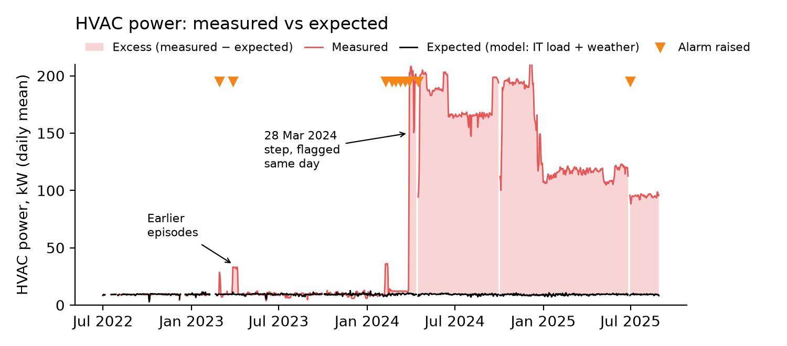

# Data Center Energy Health Check

**Every change in a data centre's energy overhead: detected, explained, priced.**

Since 2024, every EU data centre with ≥ 500 kW of IT power must report PUE, WUE, ERF and REF each year (Delegated Regulation (EU) 2024/1364). A yearly PUE tells an operator *how much* overhead the site has, but not *what changed, when, and what it costs*.

This project builds a light diagnostic service that answers those questions from meter data the site already has, and demonstrates it on 10 years of open data from the **NREL ESIF high-performance computing data centre** (Golden, Colorado).

- 📄 **Offer sheet** (1 page): [PDF](pdf/offer_sheet.pdf) · [text](docs/offer_sheet.md) · [detailed version](docs/offer_sheet_detailed.md)
- 📄 **Case study** (2 pages): [PDF](pdf/case_study.pdf) · [text](docs/case_study.md)

Labels used throughout: **[M]** measured · **[V]** validated on synthetic faults · **[E]** estimated.



## Key results
| | Result |
|---|---|
| **[M]** Yearly KPI | PUE 1.024–1.038 in 2017–2023, then **1.071 in 2024**. Overhead doubled (3.4 % → 7.1 % of IT energy), almost entirely HVAC (+1.1 GWh). |
| **[M]** Detection | On **28 Mar 2024, 20:00**, HVAC power jumped from ~12 kW to ~200 kW with no change in IT load or weather, and stayed at 95–200 kW for 17 months. Flagged **the same day**, after **four shorter episodes** in the 13 months before. Its step-wise shape points to a deliberate operating mode or a metering change, not a fault. |
| **[M]** Data gap | The energy reuse factor drops from 0.13 (2017) to 0 (2024) although heat reuse is still active: reused heat is most likely no longer metered. |
| **[V]** Detector | Finds a **~3 kW HVAC fault in ~6 days**; cooling and pump faults from 20–30 % of overhead; about **one false alarm per quarter**. |
| **[E]** Price of the change | **~1.35 GWh/yr, €110–150k, 635 tCO₂** at the real site (overhead-based PUE 1.027 → 1.083). Same site in Grenoble: ~€150k but only ~29 tCO₂. |
| **[V]** Regime-aware monitoring | With the operating mode as a declared input, a declared change raises **no alarm**, and a later 3 kW HVAC fault is still found within ~6 days. On the real data (illustrative operator log) it flagged two smaller undeclared increases. |

The open data cannot tell whether the new mode is needed. That is the operator's decision; the service makes sure it is taken **with the price on the table**, and keeps monitoring against the declared mode afterwards.

## Method
```
1-minute meter data ──► clean hourly data ──► yearly EU-style KPIs (PUE, ERF, CDD)
                                   │
                                   ▼
      baseline model: expected overhead per component, given IT load + weather
      (gradient boosting, trained on Jul 2022 – Mar 2024, blocked monthly cross-validation)
                                   │
                                   ▼
      detector: one-sided CUSUM on daily residuals, one channel per component
      (total, HVAC, pumps, cooling), threshold calibrated to ≤ 1 false alarm per quarter
                                   │
                ┌──────────────────┴──────────────────┐
                ▼                                     ▼
   validation: inject synthetic step/ramp     application to the real data:
   faults into clean data (70 start dates     alarms, excess energy, € and tCO₂
   per case), measure detection & delay       with stated assumptions
                                   │
                                   ▼
      regime-aware baseline: declared operating-mode changes are known inputs;
      per-component offset learned over a 28-day commissioning window
```

**Validation [V]**: fault size for ≥ 90 % detection within 30 days (chance level 27 %).

| Fault | Step | Ramp (30 days) | Typical delay |
|---|---|---|---|
| HVAC | 5 % of overhead (3.3 kW) | 5 % | 6 days (step), 20 days (ramp) |
| Outdoor cooling | 20 % | 30 % | 9 / 20 days |
| Pumps | 30 % | 50 % | 7 / 16 days |

Full table: [`results/fault_validation.csv`](results/fault_validation.csv).

## Reproduce
Python ≥ 3.11.
```bash
python -m venv .venv && source .venv/bin/activate
pip install -r requirements.txt
bash run_all.sh       # downloads ~170 MB, then runs every step (a few minutes on a laptop)
```

| Step | Script | Output |
|---|---|---|
| Download | `src/download.py` | `data/raw/` |
| Clean | `src/prepare.py` | `data/processed/hourly_clean.parquet` |
| Explore | `src/explore.py` | `figures/01–02` |
| KPIs | `src/kpi.py` | `results/kpi_annual.csv`, `figures/03` |
| Baseline model | `src/baseline.py` | `results/baseline_skill.csv`, out-of-fold residuals |
| Detector + validation | `src/detector.py` | `results/fault_validation.csv`, `results/detector_params.csv` |
| Real data | `src/apply.py` | `results/alarm_episodes.csv`, `figures/04` |
| Regime-aware baseline | `src/regimes.py` | `results/regime_validation.csv`, `results/regime_alarm_episodes.csv`, `docs/fig_regimes.png` |
| € and CO₂ | `src/impact.py` | `results/impact.csv` |
| Document figures | `src/figures_en.py` | `docs/fig_*.png` |
| PDFs (needs Google Chrome) | `tools/build_pdf.py` | `pdf/offer_sheet.pdf`, `pdf/case_study.pdf` |

## Limitations
- **Known events.** The earlier HVAC episodes were first spotted by eye and excluded from training and calibration, so detecting them again is not independent evidence. The synthetic-fault test is.
- **Pumps.** Pump power follows operator staging decisions that IT load and weather do not explain. This limits sensitivity to pump faults.
- **Residuals are strongly autocorrelated** (0.94 at 1 h), so the threshold is calibrated on data, not from Gaussian theory.
- **Change vs fault.** A baseline trained on the past flags *any* change. The regime-aware version needs the operator to declare mode changes; the log used here is illustrative (ESIF publishes none). The detector is one-sided: decreases are not alarms.
- **Impact.** € and CO₂ use 2024 averages. They are the running cost of the change, which is a saving only if the new mode is not needed. The Grenoble scenario assumes the same excess energy.
- **Scope.** ESIF is outside EU jurisdiction: KPIs are computed *as if* it had to report. WUE and REF cannot be computed from the open data.

## Next step: physics-based digital twin
The 28-day learning window exists because a data-driven model only knows operating modes it has seen. A grey-box digital twin (physical models of fans, pumps and heat exchangers, calibrated on design data and meters) could predict the cost of a mode before it is switched on and set the expected baseline from day one.

## Data and sources
- **Data:** NREL/NLR, *Timeseries of ESIF Data Center Power Usage Effectiveness*, CC-BY, DOI [10.7799/3015212](https://doi.org/10.7799/3015212).
- **Regulation:** Directive (EU) 2023/1791, Art. 12; Delegated Regulation (EU) 2024/1364, Annexes II–III.
- **Prices:** EIA *Electric Power Annual* Table 2.10 (Colorado 2024); Eurostat `nrg_pc_205` (France, band IE, 2024); ECB USD/EUR 2024 average.
- **Emission factors:** EPA eGRID2023 (subregion RMPA); RTE *Bilan électrique 2024* (21.7 gCO₂eq/kWh).

## License
Code: MIT. Data: CC-BY, © NREL/NLR. The data are not redistributed here: `src/download.py` fetches them from the source.
