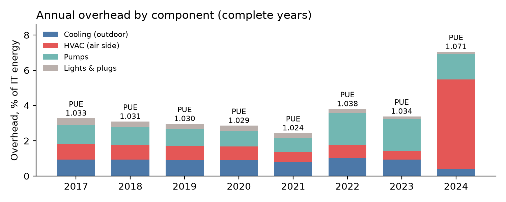
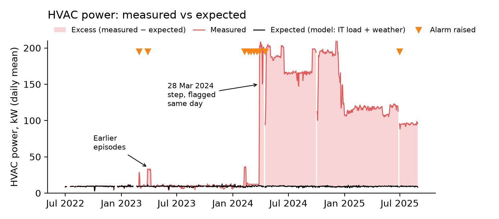
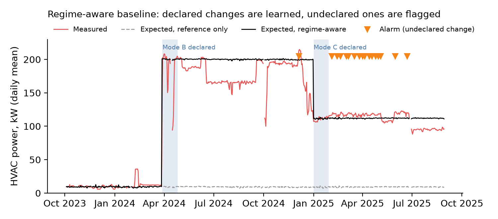

# Case study: a world-class data centre and a change no yearly KPI explains
*Data Center Energy Health Check, demonstrated on open data from the NREL ESIF HPC data centre*

## 1. The site
NREL's ESIF in Golden, Colorado, hosts a ~2.6 MW supercomputing data centre, cooled mostly with warm water, with no mechanical refrigeration and with waste-heat reuse. NREL publishes 10 years of 1-minute power data per component and on-site weather. ESIF is in the US, so its indicators are computed **as if** it had to report under Delegated Regulation (EU) 2024/1364, like every EU data centre above 500 kW.

## 2. What the yearly KPI shows

- **[M]** PUE stayed between **1.024 and 1.038** from 2017 to 2023, far below the ~1.2 typical of efficiency-focused sites. In **2024 it rose to 1.071** and the overhead doubled (3.4 % → 7.1 % of IT energy), almost all in **HVAC** (air-side fans and air handling): **+1.1 GWh** vs 2023.
- A yearly report would show this in May 2025, more than a year after it started, without saying what changed.

## 3. Detection: what changed, and when
A model learns how much power each part of the plant *should* use for a given IT load and weather, trained on the last stable period (July 2022 – March 2024). A detector compares expected and measured power every day.

- **[M]** On **28 March 2024 at 20:00**, HVAC power rose from ~12 kW to ~200 kW within two hours, with no change in IT load or weather. The detector flagged it **the same day**, and four shorter episodes in the 13 months before.
- **This is very unlikely to be a fault.** The new level lasted 17 months and changed in clean steps (200 → 165 → 195 → 115 → 95 kW), which looks like deliberate settings. The earlier episodes look like commissioning tests. The likely explanations are **a deliberate new operating mode** (for example new air-cooled equipment) or **a change in what the HVAC meter covers**. The data cannot tell which; the operator can.
- **[M]** **Heat reuse is no longer visible in the data.** The energy reuse factor (ERF) fell from 0.13 in 2017 to 0 in 2024, while NREL states that heat reuse is still active. The reuse meter has most likely stopped reporting, and the EU rules require this value.

## 4. The price of the change
| [E] per year | Energy | Cost | CO₂ |
|---|---|---|---|
| **Real site, Colorado** | 1.35 GWh (0.9–1.5) | **€110–150k** | **635 t** |
| **What-if: same site in Grenoble** | 1.35 GWh | **~€150k** | **~29 t** |

The overhead-based PUE went from an expected **1.027 to 1.083**. If the new mode is needed, this is its running cost; if not, it is the potential saving. In France the same change costs more but emits **22 times less CO₂**, because the grid is almost carbon-free. For a French operator the case is **cost and EU compliance, not carbon**.

## 5. Monitoring after a declared change
A model trained only on the past flags *any* change, wanted or not. The fix is to treat the operating mode as a **known input**. When the operator declares a new mode, the model keeps what it knows about IT load and weather and learns the new level over a 4-week commissioning window. Anything undeclared still raises an alarm.

- **[V]** On synthetic tests, a declared +100 kW change raised **no alarm** (vs 100 % for the past-only model), and a later **3 kW HVAC fault was still found within ~6 days**.
- **[M]** With an illustrative operator log (two declared modes), the detector stayed quiet on both, and flagged **two smaller undeclared increases**: a few days in Dec 2024 (up to +16 kW) and Feb–Jun 2025 (+4 kW on average above the declared level). Decreases are not alarms.

## 6. Recommendations
1. **Explain the change** (one site visit or a review of the building-management logs). Did the HVAC meter start covering new equipment on 28 March 2024? Or did the fan and air-handling controls change, and why?
2. **Decide with the price on the table.** If the mode is needed, declare it and keep monitoring against the new level. If it is not, restoring the previous operation is worth ~1.35 GWh and ~€110–150k a year. Every 10 kW of HVAC is ~88 MWh a year.
3. **Close the data gaps.** Restore heat-reuse metering (required by the EU rules and the site's strongest sustainability KPI). Log operating-mode changes and the number of running pumps, so the monitor can tell intended changes from faults.

## 7. How far can these numbers be trusted?
**[V]** Synthetic faults were injected into clean data at 70 start dates per case. Reliably detected (≥ 90 %): HVAC faults from **~3 kW** (5 % of overhead) within ~6 days, outdoor-cooling faults from 20–30 % of overhead, pump faults from 30–50 %. The threshold allows **about one false alarm per quarter**.

**Limits.** The earlier episodes were spotted by eye before being excluded from training, so finding them again is not independent proof (the synthetic test is). The operator log in section 5 is illustrative. Pump power follows staging decisions the data do not record. € and CO₂ use 2024 averages (EIA, EPA eGRID, Eurostat, RTE).

## 8. Next step: a physics-based digital twin
A data-driven model only knows modes it has seen, hence the 4-week learning window. A **grey-box digital twin** (fans, pumps and heat exchangers calibrated on design data and meters) could **predict the cost of a mode before it is switched on**.

---
*Data: NREL ESIF data centre PUE dataset (CC-BY, DOI 10.7799/3015212). Code, methods and full validation: [GitHub link].*
