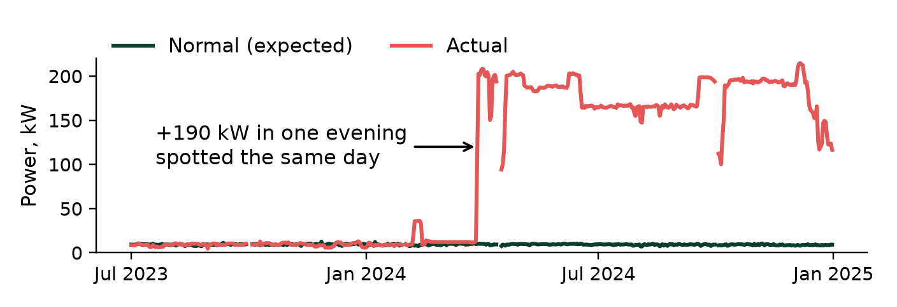

# Data Center Energy Health Check
*Know what changed in your data centre's energy use, when, and what it costs.*

### The problem
EU data centres must report their energy efficiency every year. A yearly number shows **that** something changed, but not **what**, **when** or **how much it costs**.

### The service

  

1

Learn

how much energy the site normally needs, from the meters it already has

  
&#10140;

  

2

Spot

any change, the same day it happens

  
&#10140;

  

3

Price

each change in euros: keep it, or fix it?

### Real example
Open data from a US supercomputing centre (NREL). Air-handling power, normal vs actual:

  

  

<b>Mar 2024</b> Our service: <b>same day</b>

  

<b>May 2025</b> Yearly report: <b>14 months later</b>

€130,000

per year: the cost of that single change

### Who it is for
Data-centre operators who have meters, but no time to analyse them.

---
*Full case study: attached. Code and method: [GitHub link].*
